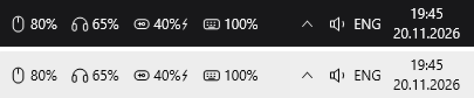
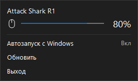
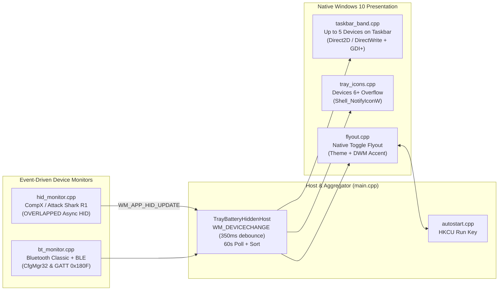

<div align="center">

# 🔋 TrayBattery

**Ultra-lightweight native C++20 Windows 10 taskbar battery monitor for wireless mice, headphones, gamepads, and Bluetooth devices.**

[](https://www.microsoft.com/windows)
[](https://isocpp.org/)
[](https://github.com/Aldiyuar/TrayBattery/actions/workflows/build.yml)
[](#)
[](LICENSE)

</div>

---

## Visual Preview

TrayBattery blends natively into the Windows 10 taskbar and notification flyouts — automatically adapting to **Dark** and **Light** system themes (`SystemUsesLightTheme`) and your **Windows accent color**.

<div align="center">

| Windows 10 Taskbar Band (Dark & Light) | Native Volume-Style Flyout |
| :---: | :---: |
|  |  |

</div>

---

## Key Features

- **Pixel-Matched Windows 10 Typography**: Renders battery percentages directly via **Direct2D + DirectWrite** (`D2D1_TEXT_ANTIALIAS_MODE_GRAYSCALE`, `Segoe UI` Regular) — identical sharpness and kerning to the Windows 10 taskbar clock.
- **Always Visible on the Taskbar**: Up to **5** connected devices sit directly on the open taskbar to the left of the tray chevron (`^`) with crisp vector outline icons (`Mouse`, `Headphones`, `Gamepad`, `Keyboard`, `Speaker`, `Phone`, `Bluetooth`).
- **Automatic Tray Overflow**: Devices beyond the first 5 overflow cleanly into standard Windows notification tray icons (`Shell_NotifyIconW`).
- **Native Windows 10 Flyout**: Clicking any taskbar item or tray icon toggles a compact native-styled popup docked flush against the taskbar (`276px` wide, 2px Windows accent battery bar, auto-hide on second click / focus loss / `Esc`).
- **Attack Shark R1 / CompX 2.4 GHz Dongle Support**: Reverse-engineered non-intrusive async `OVERLAPPED` HID listener reading live battery & charging packets without interfering with mouse input or competing with driver polling.
- **Bluetooth Classic & BLE GATT**: Queries `DEVPKEY_Bluetooth_Battery` via SetupAPI/CfgMgr32 and BLE GATT Battery Service (`0x180F`) out of the box.
- **Tiny Footprint & Zero Dependencies**: Built with `-fno-exceptions -fno-rtti` and minimal CRT shims against UCRT + Win32 SDK, producing a standalone **`~62 KB`** executable with `0%` idle CPU usage.
- **Windows Autostart**: Registers cleanly under `HKCU\Software\Microsoft\Windows\CurrentVersion\Run\TrayBattery` (toggleable right from the flyout).

---

## Architecture



---

## Supported Devices & Protocols

| Connection Type | Implementation Details | Status |
| :--- | :--- | :---: |
| **Attack Shark R1 (2.4 GHz Dongle)** | `VID_1D57&PID_FA60` (`MI_02&COL03`, `UsagePage 0x000A`) 5-byte HID report `03 10 40 <charging> <1..10>` | Verified Live |
| **CompX Wireless Receivers** | Passive `OVERLAPPED` HID listener for `VID_1D57` / `VID_3554` vendor battery endpoints + sleep detection (`>3 min`) | Supported |
| **Bluetooth / Hands-Free** | SetupAPI + CfgMgr32 `DEVPKEY_Bluetooth_Battery` with container/MAC deduplication & CoD device typing | Supported |
| **Bluetooth Low Energy (BLE)** | Native Win32 `BluetoothGATTGetCharacteristicValue` reading standard Battery Service `0x180F` | Supported |

---

## Building from Source

### Prerequisites

1. **Windows 10 / 11 (x64)**
2. **LLVM (`clang++` + `lld-link`)** — standalone [LLVM for Windows](https://releases.llvm.org/), Visual Studio LLVM toolset, or ROCm LLVM
3. **Windows 10/11 SDK** (`10.0.xxxxx.0`, `um\x64` & `ucrt\x64`)

### Compile

```powershell
.\build.ps1
```

`build.ps1` automatically detects the newest installed Windows SDK and LLVM toolchain and links `TrayBattery.exe`.

### CLI Diagnostics

Print currently detected devices, connection types, and battery percentages to the console without staying resident:

```powershell
.\TrayBattery.exe --diag
```

Sample output:

```text
HWND=0x0000000007540856 Devices=1
  [0] Attack Shark R1 | type=1 | conn=2 | bat=80% | chg=0 | online=1
```

---

## Repository Structure

```text
TrayBattery/
├── .github/workflows/build.yml   # Automated Windows CI build & executable artifact
├── assets/
│   ├── taskbar-preview.png       # Dark & Light taskbar showcase render
│   └── flyout-preview.png        # Windows 10 flyout render
├── src/
│   ├── common.h                  # Device structs, enums & shared helpers
│   ├── main.cpp                  # Entry point, single-instance mutex & WM_DEVICECHANGE host
│   ├── hid_monitor.cpp/.h        # Async OVERLAPPED HID thread (Attack Shark R1 / CompX)
│   ├── bt_monitor.cpp/.h         # Bluetooth Classic & BLE GATT battery collector
│   ├── taskbar_band.cpp/.h       # Owned layered taskbar overlay (DirectWrite + GDI+)
│   ├── tray_icons.cpp/.h         # Overflow system tray icon manager (devices 6+)
│   ├── flyout.cpp/.h             # Native Windows 10 adaptive toggle flyout
│   ├── autostart.cpp/.h          # HKCU Run key management
│   └── crt_shims.cpp             # Minimal freestanding CRT intrinsics & __chkstk
├── build.ps1                     # Zero-dependency PowerShell build script
├── .gitignore
├── LICENSE
└── README.md
```

---

## License

Released under the [MIT License](LICENSE).
